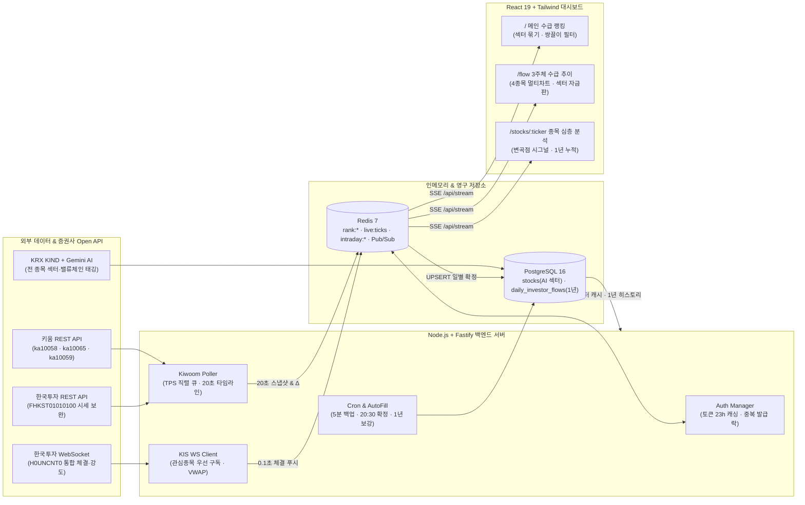

# 📡 KRX · NXT 실시간 수급 레이더 (Real-time Investor Flow Radar)


> **한국거래소(KRX) · 넥스트레이드(NXT) 통합 시장의 프리마켓(08:00)부터 정규장, 애프터마켓(20:00)까지 12시간 누적 투자자별(외국인·기관·개인) 수급, Gemini AI 기반 전 종목 섹터·밸류체인 분류, 20초 단위 3주체 실시간 자금 흐름 및 1년치 일별 수급 시계열을 추적하는 풀스택 수급 분석 대시보드**

---

## 🏗️ 시스템 아키텍처 (System Architecture)



---

## ✨ 핵심 기능 (Key Features)

| 영역 | 상세 구현 내용 |
| :--- | :--- |
| **KRX·NXT 12시간 통합 수급** | 모든 키움 수급 조회에 `stex_tp: '3'`을 적용해 프리마켓(08:00)~애프터마켓(20:00) 누적 거래대금을 20초마다 갱신하고, 기관 5대 주체(금융투자·투신·사모·연기금·보험) 합산 및 매수/매도 상호 배타 정제를 수행합니다. |
| **인증 안정화 및 토큰 중앙 캐싱** | 키움·한투 OAuth 토큰 및 WebSocket 접속키를 Redis에 23시간 캐싱하고, 동시 요청 시 토큰 중복 발급으로 인한 인증 충돌(`8005`)을 Promise 락(Lock)으로 차단합니다. |
| **AI 전 종목 섹터·밸류체인 태깅** | 한국거래소(KIND) 상장 2,725개 법인의 업종·주요제품 데이터를 Gemini AI로 분석해 16대 핵심 섹터(`sector_main`), 12자 이내 세부 밸류체인(`sector_sub`), 한 줄 요약(`biz_summary`)을 자동 부여하고 대시보드에서 수동 편집도 지원합니다. |
| **3개 독립 뷰 & 멀티 차트 관제** | 메인 랭킹(`/`), 3주체 수급 추이(`/flow`), 개별 종목 심층 분석(`/stocks/:ticker`)의 독립 URL 라우팅과 슬라이드 인사이트 패널을 제공하며, `/flow`에서 최대 4개 관심 종목의 실시간 3주체 수급 그래프를 동시에 관제합니다. |
| **실시간 체결강도 & 수급 변곡점 감지** | 조회 중인 종목을 한투 WebSocket(`H0UNCNT0`) 최우선 슬롯에 즉시 등록해 실시간 체결가·체결강도(`%`)·당일 평균단가(`VWAP`)를 스트리밍하고, 장중 순매수 전환·눌림목 쌍끌이 매집 시그널을 자동 판별합니다. |
| **1년치(250영업일) 일별 수급 분석** | 배치 소급 스크립트(`backfill-history.mjs`)와 종목 조회 시 자동 보강(`ka10059`)을 통해 최근 1년간 일별 외국인·기관·개인 확정 수급, 기간별(5일·20일·60일·250일) 누적 합계, 다일간 연속 순매수 종목을 추적합니다. |

---

## 📋 사전 준비물 (Prerequisites & API Keys)

1. **로컬 실행 환경**
   * **Node.js `v22.x` 이상** (`--env-file` 네이티브 플래그 지원 필수, `v24.x` 권장)
   * **Docker & Docker Compose** (Windows 환경에서는 Docker Desktop 실행 후 WSL2 Ubuntu 터미널 사용 권장)
2. **필수 API 키 3종 발급**
   * **키움증권 REST API (`KIWOOM_APP_KEY`, `KIWOOM_SECRET_KEY`):** [키움 REST API 포털](https://openapi.kiwoom.com)에서 실전 App Key 발급 후, **계좌 App Key 관리 메뉴에 현재 접속 중인 공인 IP를 반드시 등록**해야 합니다.
   * **한국투자증권 KIS Open API (`KIS_APP_KEY`, `KIS_APP_SECRET`):** [KIS Developers](https://apiportal.koreainvestment.com)에서 실전 투자 계좌 기반 App Key 및 App Secret을 발급받습니다.
   * **Google Gemini API (`GEMINI_API_KEY`):** [Google AI Studio](https://aistudio.google.com/apikey)에서 `AIza...`로 시작하는 무료 API 키를 발급받습니다. *(미입력 시에도 공시 업종·주요제품 기반 1차 규칙 분류로 자동 동작합니다.)*

---

## 🚀 처음부터 구축 및 실행하기 (Step-by-Step Setup)

### 1단계: 저장소 복제 및 인프라(PostgreSQL 16 · Redis 7) 기동
```bash
git clone [https://github.com/leegandhi18/krx-nxt-flow-radar.git](https://github.com/leegandhi18/krx-nxt-flow-radar.git)
cd krx-nxt-flow-radar

docker compose up -d
docker exec -i krx-postgres psql -U dev -d krx_flow < schema.sql
```
* **정상 확인:** `docker exec krx-redis redis-cli ping` 입력 시 `PONG`이 출력되고, `docker exec krx-postgres psql -U dev -d krx_flow -c "\dt"` 입력 시 `stocks`와 `daily_investor_flows` 테이블이 표시되면 완료입니다.

### 2단계: 환경 변수(`.env`) 작성
```bash
cp .env.example .env
nano .env
```
* `.env` 파일 내부의 `KIWOOM_APP_KEY`, `KIWOOM_SECRET_KEY`, `KIS_APP_KEY`, `KIS_APP_SECRET`, `GEMINI_API_KEY` 항목에 발급받은 실제 키를 입력하고 저장합니다. *(절대 `.env` 파일을 Git에 커밋하지 마세요.)*

### 3단계: 패키지 설치 및 초기 데이터 적재 (최초 1회)
```bash
npm install
cd web && npm install && cd ..

# 1) KRX 상장 전 종목(약 2,725개) AI 섹터·밸류체인 라벨링 (약 1~2분 소요)
node --env-file=.env scripts/sync-sectors.mjs

# 2) 최근 1년(250영업일) 일별 투자자 확정 수급 소급 적재 (약 15~20분 소요, 중단 후 이어받기 지원)
node --env-file=.env scripts/backfill-history.mjs 250
```
* **정상 확인:** `docker exec krx-postgres psql -U dev -d krx_flow -c "SELECT COUNT(*) FROM stocks WHERE sector_main IS NOT NULL;"` 실행 시 `2700`건 이상이 조회되면 준비 완료입니다.

### 4단계: 백엔드 API & 프론트엔드 대시보드 실행
터미널 창 2개를 열어 각각 실행합니다.

```bash
# [터미널 1] 백엔드 수집기 & 실시간 SSE 서버 실행 (http://localhost:4000)
npm run dev
```
```bash
# [터미널 2] React 웹 대시보드 실행 (http://localhost:5173)
cd web
npm run dev
```
* **정상 확인:**
  1. 터미널 1에 `[SectorCache] 전 종목 상세 라벨 ...건 메모리 로드 완료` 및 `[Server] API & SSE 서버 가동 완료 → http://localhost:4000` 로그가 출력됩니다.
  2. 브라우저에서 **`http://localhost:5173`** 접속 시 상단 `실시간 스트림` 뱃지가 녹색으로 점등되고 3단 수급 순위와 섹터 라벨이 표시됩니다.

---

## ⏰ 장 운영 시간대별 데이터 수집 및 정산 기준

* **08:00 ~ 20:00 (프리장 · 정규장 · 애프터마켓):** 20초 간격으로 KRX·NXT 통합(`stex_tp: '3'`) 당일 누적 수급을 수집하고 Redis 타임라인(`intraday:timeline`)에 기록하며, 5분마다 PostgreSQL에 중간 백업합니다.
* **15:42 / 20:06 / 20:30 (자동 정산 스케줄러):** 정규장 마감 1차 집계(15:42) 후 애프터마켓 종료 시점(20:06, 20:30)에 거래소 일별 최종 확정치(`is_finalized = TRUE`)로 DB를 자동 갱신합니다.
* **일반 MTS/HTS와의 수치 차이 안내:** 일부 증권사 앱의 메인 순위는 정규장 마감(`15:38`) 스냅샷에 고정되는 반면, 본 대시보드는 08:00~20:00 전 시간대 KRX·NXT 체결 대금을 실시간 합산하므로 애프터마켓 거래 비중이 큰 대형주에서 차이가 발생할 수 있으며 `20:30` 최종 정산 시 수렴합니다.

---

## 🛠️ 자주 발생하는 오류 해결 (Troubleshooting)

| 오류 증상 / 코드 | 원인 | 해결 방법 |
| :--- | :--- | :--- |
| **`[8050] 지정된 IP가 아닙니다`** | 키움 포털에 등록된 IP와 현재 PC의 외부 공인 IP가 다름 | `curl -s ifconfig.me`로 현재 공인 IP를 확인한 뒤 [키움 REST API 포털](https://openapi.kiwoom.com) > 계좌 App Key 관리에 IP 등록 |
| **`[8005] Token이 유효하지 않습니다`** | 서버 중복 실행 또는 캐싱된 만료 토큰 충돌 | 중복 실행 프로세스 종료 후 `docker exec krx-redis redis-cli DEL auth:kiwoom:token` 실행 뒤 백엔드 재시작 |
| **`Gemini API HTTP 401`** | `AQ.` 형식의 GCP 키 사용 또는 키 오타 | Google AI Studio에서 `AIza...`로 시작하는 표준 키를 발급받아 `.env`의 `GEMINI_API_KEY` 교체 |
| **서버 실행 시 `[Boot 1/4]` 전 무응답 대기** | Docker 컨테이너(`krx-postgres`, `krx-redis`) 중지 상태 | Docker Desktop 실행 후 `docker compose up -d`로 컨테이너를 먼저 기동 |

---

## 📂 디렉터리 구조 (Project Structure)

```text
krx-flow/
├── docker-compose.yaml            # PostgreSQL 16 & Redis 7 로컬 컨테이너 구성
├── schema.sql                     # stocks(AI 섹터) & daily_investor_flows 테이블 DDL
├── .env.example                   # 환경 변수 템플릿 (키움 · 한투 · Gemini · DB/Redis)
├── scripts/
│   ├── sync-sectors.mjs           # KRX(KIND) + Gemini AI 전 종목 섹터·밸류체인 일괄 태깅
│   └── backfill-history.mjs       # 최근 1년(250영업일) 과거 일별 확정 수급 소급 적재기
├── src/
│   ├── authManager.js             # 키움·한투 OAuth 토큰 중앙 캐싱 및 중복 발급 방지 락
│   ├── kiwoomPoller.js            # 100종목 연속조회 · TPS 직렬 큐 · 20초 3주체 타임라인 기록
│   ├── kisWsClient.js             # 한투 통합 체결가(H0UNCNT0) 우선순위 구독 & 체결강도 파싱
│   └── server.js                  # Fastify REST API · SSE 스트림 · 섹터 캐시 · 1년 수급 자동 보강
└── web/
    ├── index.html
    ├── package.json
    ├── vite.config.js
    └── src/
        ├── main.jsx
        ├── index.css
        └── App.jsx                # /, /flow, /stocks/:ticker 라우팅 · 4종목 멀티 차트 · 인사이트 패널
```

---

## 🔌 주요 API 명세 (Endpoints)

| Method | Endpoint | 설명 |
| :--- | :--- | :--- |
| `GET` | `/api/health` | 서버 장 운영 세션, Redis·PostgreSQL 연결 상태 및 메모리 로드된 섹터 건수 확인 |
| `GET` | `/api/rankings` | 외국인·기관·개인 순매수/순매도 TOP 100, AI 섹터 라벨, 실시간 체결강도, 쌍끌이·3주체 플래그 반환 |
| `GET` | `/api/intraday-flow` | 장중 20초 단위 시장 전체 3주체 시계열, 섹터별 자금 유입/유출 현황판, 종목별 직전 대비 증감(`Δ`) 조회 |
| `GET` | `/api/intraday-flow/batch` | 멀티 차트용 최대 4개 종목 일괄 실시간 수급 추이 조회 및 WebSocket 최우선 구독 등록 (`?tickers=...`) |
| `GET` | `/api/intraday-flow/:ticker` | 개별 종목 당일 20초 단위 3주체 추이, 실시간 체결강도·VWAP 및 수급 변곡점 시그널 반환 |
| `GET` | `/api/consecutive` | PostgreSQL 누적 데이터 기반 N일 연속 순매수 종목 및 누적 매수대금 조회 (`?days=3&investor=foreign`) |
| `GET` | `/api/stocks/:ticker/history` | 종목별 최근 1년(최대 365거래일) 일별 확정 수급 조회 (DB 부족 시 `ka10059` 자동 보강) |
| `PATCH` | `/api/stocks/:ticker/sector` | 특정 종목의 대분류 섹터·세부 밸류체인·사업 요약 수동 수정 및 메모리 캐시 즉시 갱신 |
| `GET` | `/api/stream` | 실시간 수급 순위(`rank_update`) 및 0.1초 체결가·체결강도(`tick_update`) SSE 스트림 |
